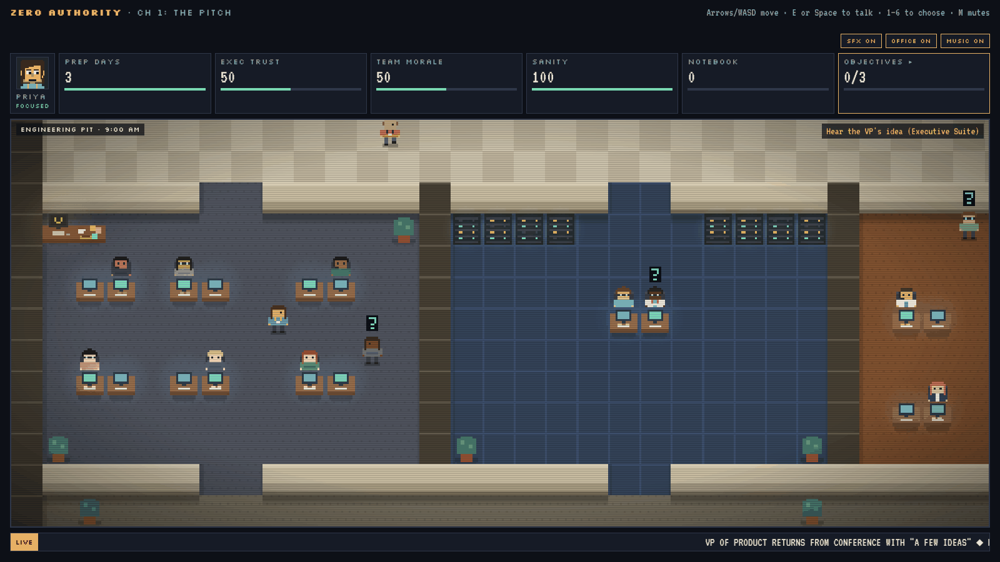
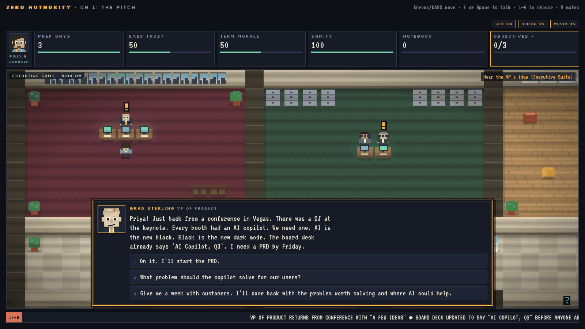
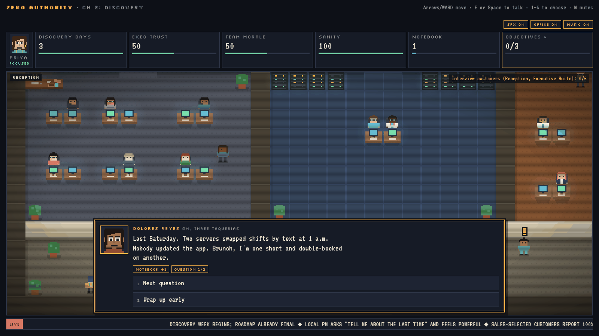
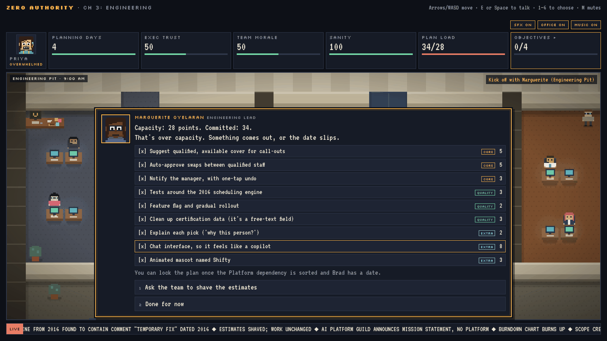
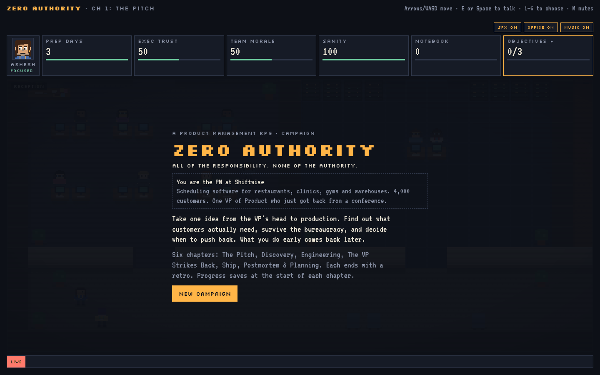
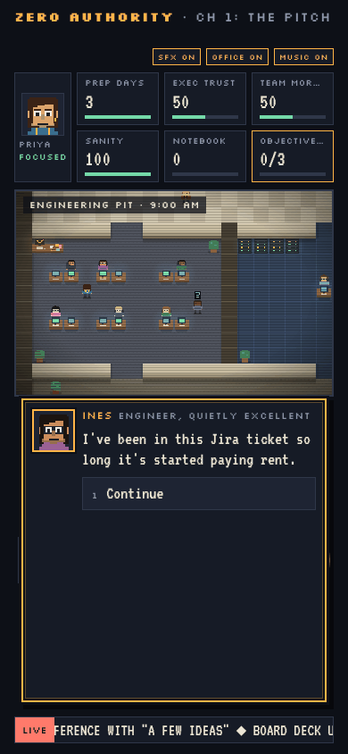

# Zero Authority

*All of the responsibility. None of the authority.*

A pixel-art RPG about product management. You're the new PM at Shiftwise, a shift-scheduling company. Your VP just got back from a conference with an idea, and it's already in the board deck.

Take that idea from pitch to postmortem without losing your team, your exec, or your mind.

**[Play it in your browser →](https://pm-simulator-game.vercel.app/)**

## The campaign

Six chapters. Your choices carry forward, and the game remembers what you cut, promised and skipped.

| Chapter | What happens | What it teaches |
|---|---|---|
| 1. The Pitch | Brad wants an AI copilot. Legal wants Form CR-7. You pick who to interview. | An exec's idea is a hypothesis. Who you talk to decides what you hear. |
| 2. Discovery | Interview a mixed crowd of customers, three questions each, then synthesize. | Ask about the past, not the future. Compliments aren't evidence. |
| 3. Engineering | A scope board that's over capacity, a reorg, a 2016 scheduling engine, and a date for the board. | Cut scope, not quality. Estimates are ranges. Dependencies are schedule. |
| 4. The VP Strikes Back | Competitor parity, a sales deal with strings, an unsourced marketing claim, a board demo. | Make trade-offs visible and let the person asking own the choice. |
| 5. Ship | Rollout plan, legal sign-off, a launch metric, then whatever you cut comes back as an incident. | Ship behind a flag, baseline first, pick the metric that could prove you wrong. |
| 6. Postmortem & Planning | A blameless postmortem, a kill-or-keep decision, fairness fallout, and next quarter's plan. | Systems over people, sunk cost, second-order effects, small experiments over big bets. |

Along the way:

- **Team morale and exec trust are currencies.** Low morale slows the team and someone eventually quits. Low trust means decisions get made without you, a shadow PM named Tyler, and eventually a PIP.
- **One-way and two-way doors.** Reversible choices are quick. Irreversible ones ask you to confirm.
- **Your PM has a face** that reacts to how things are going, and thoughts you'll recognise.
- **Your desk in the Engineering Pit** has Claudia, an AI assistant, plus Jira and the Release Train dashboard.
- Several endings, a performance review, and eight lessons worth keeping.

## Screenshots

| | |
|---|---|
|  |  |
| **The Pitch.** Brad is back from Vegas, and the board deck already says "AI Copilot". | **Discovery.** Three questions per customer. Stories are evidence; compliments aren't. |
|  |  |
| **Engineering.** The scope board starts over capacity. Cut scope, not quality. | **Title screen.** |

 <em>On a phone, with on-screen controls.</em>

## Screen sizes

The game scales to fit the window on phones, laptops and large monitors, so you never have to scroll. On touch devices it shows an on-screen D-pad and TALK button.

## First time?

New players get a one-minute orientation: walk, talk to someone, then a quick tour of the HUD, objectives, choices and your desk. You can skip it, and replay it any time from Claudia on your desk.

## Controls

- **Move:** arrow keys or WASD (on-screen D-pad on phones)
- **Talk / interact:** E, Space or Enter (TALK button on phones)
- **Pick a choice:** click, or press 1–6
- **Mute:** M, or the SFX / OFFICE / MUSIC toggles

Progress saves in your browser at the start of each chapter.

## Run it locally

It's a single HTML file with no build step and no dependencies. Open `index.html` in a browser.

Everything is generated in code: pixel art is drawn on a canvas, and sound and music are synthesised with the Web Audio API. The only external request is two Google Fonts (Silkscreen and VT323), and the game falls back to a monospace font without them.

## Deploying

Any static host works. On Vercel, import the repo with no framework and no build command. `vercel.json` sets `index.html` to revalidate on every request so players always get the latest version.

Saves live in each player's `localStorage`, keyed to the domain. If you change the shape of the saved campaign state, older saves may need handling.

## Credits

Made by [CorithLabs](https://github.com/CorithLabs). Inspired by [Civic Nightmare](https://github.com/Daniele-Cangi/civic-nightmare).

All characters and companies are fictional.

## License

[MIT](LICENSE)
